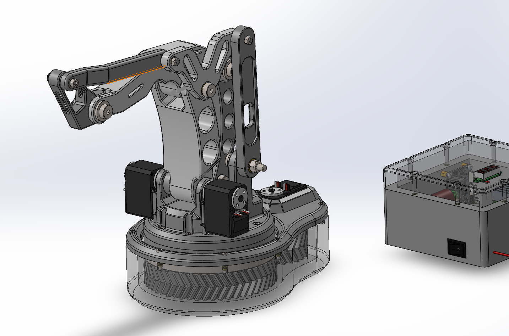
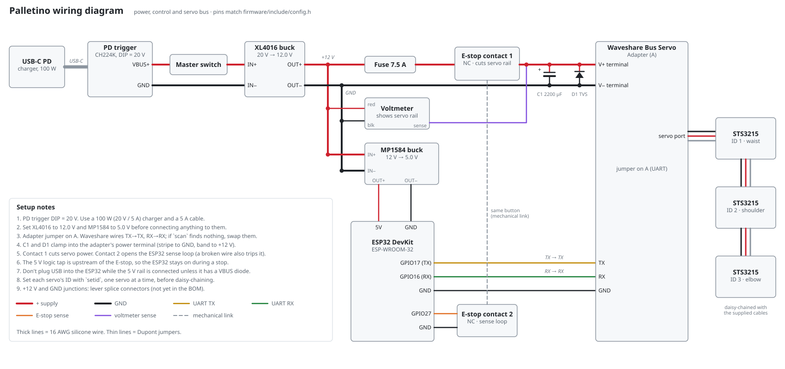

# 3DOF-Picker-Placer: Palletino

*Work-in-progress*

A cheap, easily-assembled, trainable 3-DOF robot arm, designed so anyone could build one from a parts list. Built around a parallelogram linkage topology referenced from Fanuc/KUKA/Panasonic palletizing robots, with topology-optimized structural links for FDM printing.

## Goals
- Cheap, off-the-shelf smart servos + printed structure, no exotic parts
- Easy to assemble: clear BOM, standard fasteners, no proprietary hardware
- Precise, not sprawling; deliberately 3 DOF (waist / shoulder / elbow) instead of chasing 6 DOF. The bet is that a tight, repeatable 3-DOF arm is more useful than a loose 6-DOF one, and it keeps cost and build complexity down
- Trainable — kinesthetic teach-and-repeat via torque-disabled smart servos, no separate programming step needed to record a motion (in progress)
- Modular at the tool end: swappable tool heads (dial gauge for precision validation, vacuum head for palletizing/pick-and-place, optional 4th-DOF wrist) instead of building capability into the arm itself
- Designed to perfom most of the same tasks as 6DOF robot arms, with less hassle and more accessiblilty

## Status
V3.2 base (waist joint, herringbone 2:1 reduction, swivel bearing, and electronics) designed and added to the repo. Firmware started but not tested. See devlogs for the full history.

### Specs at a glance
	
- DOF 3 (waist, shoulder, elbow) + optional 4th-DOF tool head
- Actuators	3× Feetech STS3215 smart servo, daisy-chained
- Controller	ESP32 + Waveshare Bus Servo Adapter (UART)
- Power	USB-C PD (20V, primary) or XT60 bench/battery tap (alternate) → 12V servo bus / 5V logic
- Structure	FDM PETG (V1/V2), aluminum machining planned for later versions
- Base reduction	2:1 herringbone gear, waist joint

## Wiring
<picture>
  <source media="(prefers-color-scheme: dark)" srcset="hardware/wiring/palletino-wiring-overview-dark.svg">
  
</picture>
